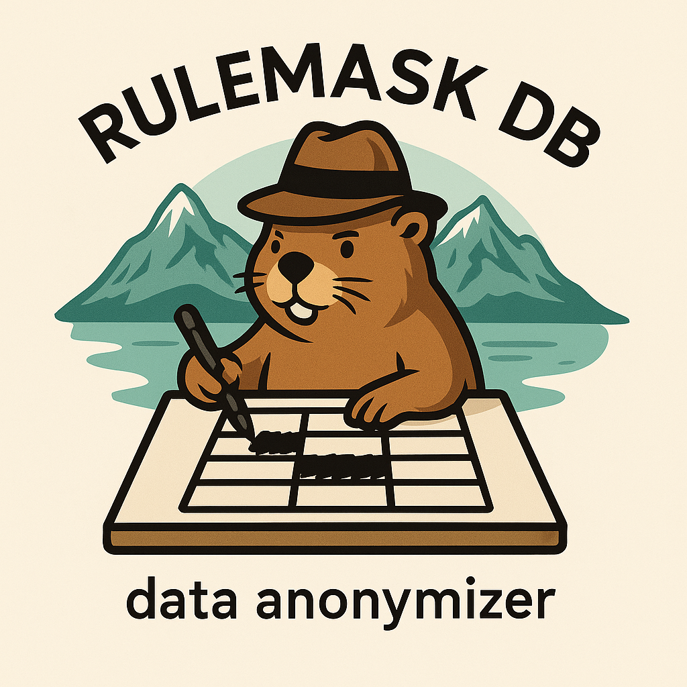
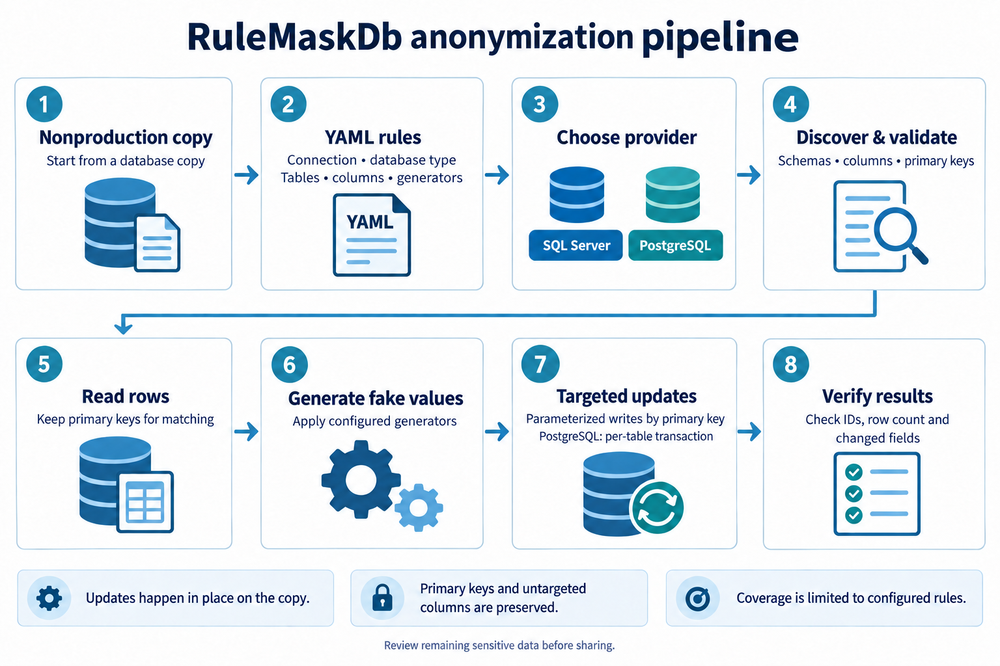
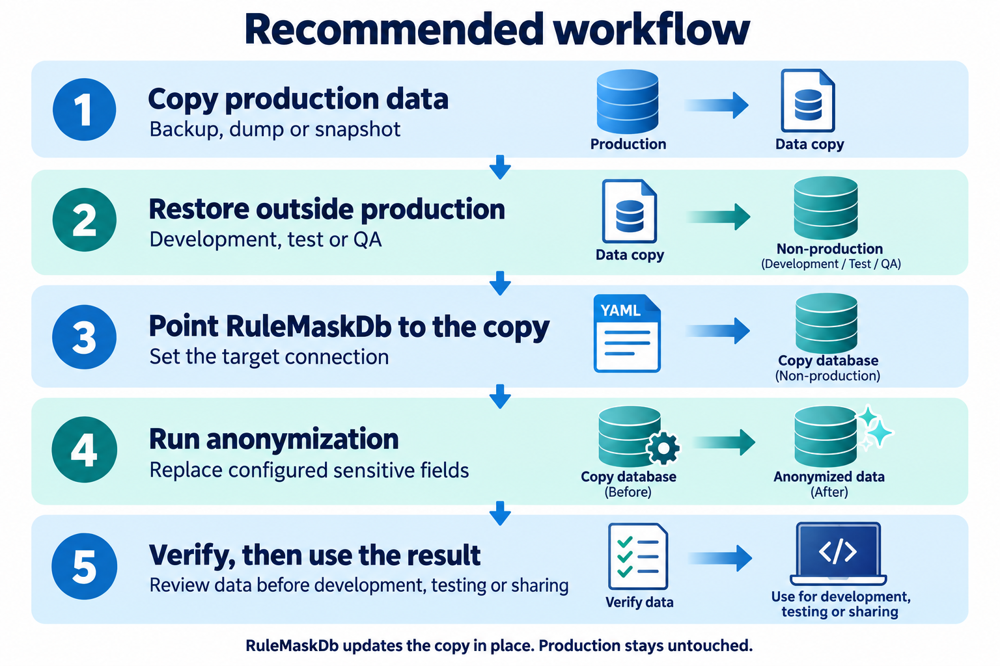
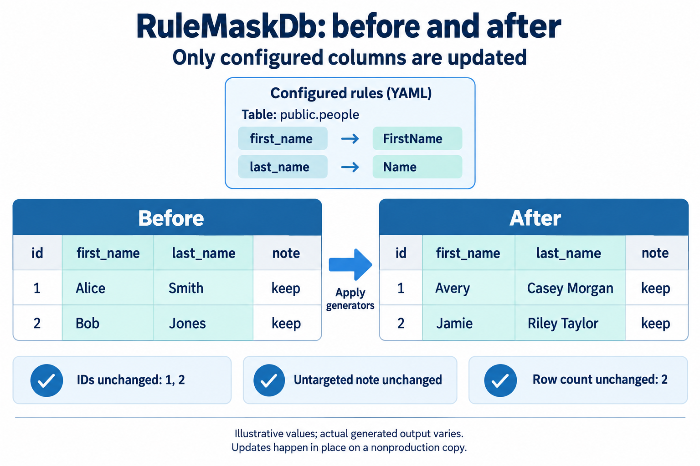

# RuleMaskDb

RuleMaskDb replaces configured sensitive fields directly in a target database using YAML rules and Bogus generators. SQL Server and PostgreSQL are supported; RavenDB is reserved but not implemented. Requires .NET 10.



## In-place anonymization

Use a non-production copy. RuleMaskDb does not clone the database. Only configured columns are covered; review the resulting data for your privacy requirements.



## Recommended workflow

1. Create a copy of your production database (backup, dump or snapshot).
2. Restore it in a non-production environment (development, test or QA).
3. Point RuleMaskDb to this copy using the target connection in your YAML configuration.
4. Run anonymization to replace the configured sensitive fields.
5. Verify the resulting data, then use it for development, testing or sharing.



## PostgreSQL example

See [the runnable YAML example](docs/examples/postgresql.yaml). Its demo credentials refer to the disposable test container below.

```yaml
database:
  type: PostgreSQL
  connectionString: 'Host=127.0.0.1;Port=55433;Database=rulemask_test;Username=postgres;Password=rulemask_test_only'
rules:
  - table: public.people
    column: first_name
    generator: FirstName
  - table: public.people
    column: last_name
    generator: LastName
```

From the repository root (PowerShell):

```powershell
$script = (Resolve-Path docs/examples/postgresql.yaml).Path
dotnet run --project src/RuleMaskDb/RuleMaskDb.ConsoleApp -- describe --script $script
dotnet run --project src/RuleMaskDb/RuleMaskDb.ConsoleApp -- run --script $script
```

For SQL Server, use `type: SqlServer`, a SqlClient connection string, and table names such as `dbo.People`. An omitted type defaults to SQL Server; unknown types are rejected.

Use the exact `schema.table` and column names reported by `describe`, including case. These are literal metadata names, not SQL fragments: do not add SQL brackets or double-quote delimiters. Quote YAML strings when necessary. Schema and table identifiers are escaped separately for SQL execution; embedded spaces, dots, brackets and quotes are supported. Ambiguous concatenated table names are rejected.



## Engine behavior

The CLI dispatches schema discovery to the selected provider. A shared ADO.NET runner reads original primary keys and targeted values, generates replacement values and issues parameterized updates using every component of the primary key. Only targeted columns appear in `SET`; primary keys and untargeted columns are not assigned by the engine.

Targeted fields containing SQL `NULL` or an empty string (`""`) are preserved without calling their generator, including plugin generators. Whitespace-only strings, zero and `false` are still anonymized. Rows with no populated targeted fields are not updated, but still count toward progress. This behavior applies to both SQL Server and PostgreSQL.

All rule targets are validated before writes. Missing tables/columns, duplicate column rules, primary-key rules and tables without primary keys fail explicitly. PostgreSQL discovers ordinary and partitioned tables (partition children are not processed twice), columns and primary keys; row counts are exact and may be expensive on large databases.

PostgreSQL commits each table independently and rolls back the current table on failure or cancellation. Previously committed tables remain changed. SQL Server retains row-by-row autocommit, avoiding a long updater transaction that could block its separate streaming reader. Run against an otherwise idle database copy. Database triggers, constraints and generated columns still apply: incompatible values can fail; triggers can have additional effects.

Generators must fit the target column type, length and constraints. Values are normally random; uniqueness and referential consistency for non-PK columns are not guaranteed. `Name` produces a full name. If no generator is supplied, `Name` is used. The legacy `mask` property is parsed but is not applied by the engine.

## First names, surnames and mapped parameters

Use `FirstName` for a given name, `LastName` for a surname, and `Name` for a full name. Existing `Name` rules keep their meaning; change surname rules explicitly to `LastName`. A surname can naturally contain spaces: `LastName` does not guarantee a single word.

Generator parameters can read another column in the **same original row** and map database-specific codes to provider-independent values:

```yaml
rules:
  - table: dbo.Customers
    column: FirstName
    generator: FirstName
    parameters:
      gender:
        column: Title
        mapping:
          "M.": Male
          "Mme": Female
        fallback: Unknown
  - table: dbo.Customers
    column: LastName
    generator: LastName
```

Here `gender` resolves to the SDK enum `RuleMaskDb.Sdk.Gender`: `Male`, `Female`, or `Unknown`. The Bogus adapter converts those values to Bogus's enum. `Unknown` (or no resolved parameter) calls Bogus without a gender constraint; it does not select a special neutral-name list. No gender is inferred from an existing name.

Mapping rules:

- Each parameter accepts either a fixed `value` or a source `column`, never both. Fixed values cannot have a mapping or fallback.
- Column names and mapping keys are exact and case-sensitive; no trimming is performed.
- Database values are converted to strings using invariant culture. For numeric codes use quoted YAML keys, such as `"1": Male` and `"2": Female`. Boolean keys are `"True"` and `"False"`.
- SQL NULL and unmatched values use `fallback`. An empty string is matched by `"": ...` if configured, otherwise it also uses the fallback.
- Without a fallback, an unmatched parameter is omitted. For `FirstName.gender`, omission means `Unknown`.
- With a column but no `mapping`, the original value is passed directly; SQL NULL and empty strings use the fallback (or omit the parameter). An explicit empty mapping (`mapping: {}`) still uses mapping semantics.
- Enum output names are case-insensitive. Numeric enum outputs and invalid names are rejected.
- Missing source columns, invalid gender mappings/fallbacks, unknown FirstName parameters and parameters on generators that do not support them fail before any update connections are opened.
- All source values are captured before generators run. A source column can also be anonymized by another rule: mapping still uses its original value, independent of rule order.
- Source columns are only read unless explicitly targeted by their own rule. Null/empty target values remain skipped as described above.

Bogus supports gender-specific first names only for locales containing the corresponding lists. The default locale remains `en`; use the `culture` parameter below to select another locale. The adapter rejects explicit Male/Female values if the selected locale lacks that capability.

This feature does not preserve or force compound first names. It uses the selected Bogus name list as supplied; controlling the number of name components is a separate feature.

### Generator cultures

All built-in generators accept a `culture` parameter using .NET culture names. Fix a culture, map database-specific codes, or read a culture directly from a column:

```yaml
rules:
  - table: dbo.Customers
    column: PhoneNumber
    generator: PhoneNumber
    parameters:
      culture:
        value: fr-FR
  - table: dbo.Customers
    column: Address
    generator: AddressLine
    parameters:
      culture:
        column: CountryCode
        mapping:
          "FR": fr-FR
          "GB": en-GB
          "DE": de-DE
          "CA": fr-CA
        fallback: fr-FR
  - table: dbo.Customers
    column: City
    generator: City
    parameters:
      culture:
        column: CultureCode
        fallback: fr-FR
```

The adapter translates supported .NET cultures to verified Bogus locales (for example, `fr-FR → fr`, `en-GB → en_GB`). It does not modify the process/thread culture. Omitting the parameter retains the current English default. Generators whose data is culture-independent can produce the same formats regardless of culture.

Fixed values, mapping outputs and fallbacks are checked before updates. Unmapped direct-column values are checked as each populated target row is processed; invalid values fail rather than silently choosing another locale. Existing transaction/partial-update behavior still applies. Bogus can internally fall back to English for missing parts of a supported locale's dataset.

See [generator culture configuration](docs/generator-cultures.md) for all three modes, compatibility rules, combined gender/culture generation, and plugin guidance.

### Context-aware plugins

Existing plugins implementing only `IDataGenerator` work unchanged for rules without parameters. To consume parameters, additionally implement `IContextualDataGenerator`:

```csharp
using RuleMaskDb.Sdk;

[Generator("CustomerSegment")]
public sealed class CustomerSegmentGenerator : IContextualDataGenerator
{
    public enum Segment { Unknown, Retail, Business }

    public void ValidateParameters(
        IReadOnlyDictionary<string, IReadOnlyCollection<string>> possibleValues)
    {
        foreach (var (name, values) in possibleValues)
        {
            if (name != "segment")
                throw new InvalidOperationException($"Unknown parameter: {name}");
            foreach (var value in values)
                _ = new GenerationContext(
                    new Dictionary<string, string> { [name] = value })
                    .GetEnum("segment", Segment.Unknown);
        }
    }

    public Task<object> GenerateValueAsync(CancellationToken cancellationToken = default)
        => GenerateValueAsync(GenerationContext.Empty, cancellationToken);

    public Task<object> GenerateValueAsync(
        GenerationContext context, CancellationToken cancellationToken = default)
    {
        cancellationToken.ThrowIfCancellationRequested();
        var segment = context.GetEnum("segment", Segment.Unknown);
        return Task.FromResult<object>($"anonymous-{segment}");
    }
}
```

The same mapping mechanism can supply that plugin's own enum:

```yaml
rules:
  - table: dbo.Customers
    column: DisplayName
    generator: CustomerSegment
    parameters:
      segment:
        column: CustomerType
        mapping:
          "P": Retail
          "C": Business
        fallback: Unknown
```

`ValidateParameters` receives every fixed value, configured mapping output and fallback during preflight, including values not currently present in the database. Direct-column values are only known while processing rows; plugins must validate them during generation as well. `GenerateValueAsync` receives a read-only snapshot of resolved parameters for one row, not the entire row. Plugins can use `context.GetCulture()` to read a .NET `CultureInfo` (or null if omitted). The SDK has no dependency on Bogus. Old plugins reject configured parameters explicitly rather than silently ignoring them.

## Generator plugins

The `Sdk` project builds `RuleMaskDb.Sdk.dll` and has no dependency on the engine or Bogus. Reference it from a .NET 10 class library, implement `RuleMaskDb.Sdk.IDataGenerator`, and annotate a public class with `[Generator("YourName")]`. The class must have a public parameterless constructor. One instance is created per configured column; `GenerateValueAsync` receives the run's cancellation token.

The included `RuleMaskDb.LocalEmailPlugin` is a complete example:

```csharp
using RuleMaskDb.Sdk;

[Generator("LocalEmail")]
public sealed class LocalEmailGenerator : IDataGenerator
{
    public Task<object> GenerateValueAsync(CancellationToken cancellationToken = default)
    {
        cancellationToken.ThrowIfCancellationRequested();
        return Task.FromResult<object>($"user-{Guid.NewGuid():N}@local");
    }
}
```

By default the CLI discovers DLLs in `plugins` beside its executable, including subdirectories. Alternatively set `RULEMASK_PLUGINS_DIRECTORY` to a plugin directory (relative paths are relative to the working directory). Keep each plugin and its dependencies together, preferably in its own subdirectory; publishing the class library supplies its dependencies and `.deps.json`. The host shares its SDK assembly with every plugin. Install only trusted DLLs: plugins execute inside the application process. Restart the application after changing plugins.

Build and discover the example from the repository root in PowerShell:

```powershell
dotnet build src/RuleMaskDb/RuleMaskDb.slnx
$env:RULEMASK_PLUGINS_DIRECTORY = (Resolve-Path src/RuleMaskDb/RuleMaskDb.LocalEmailPlugin/bin/Debug/net10.0).Path
dotnet run --project src/RuleMaskDb/RuleMaskDb.ConsoleApp -- plugins
# Run your YAML using this same environment:
# dotnet run --project src/RuleMaskDb/RuleMaskDb.ConsoleApp -- run --script $script
```

Select the plugin by name for a column:

```yaml
rules:
  - table: public.people
    column: email
    generator: LocalEmail
```

`LocalEmail` always produces an address ending in `@local`. Names are matched without regard to case. Plugins take priority over built-in generators: naming a plugin `Email` overrides the built-in `Email`. Duplicate names between plugins and invalid generator declarations are errors. Missing or blank names still default to `Name`; unknown names fail before any database updates. DLL loading failures include the file path in the error. A missing plugin directory simply leaves the built-in generators available. The example plugin is installed explicitly and is not bundled into the CLI automatically.

## Reproducible PostgreSQL tests

Create a dedicated container; ports 5432 and 5433 and existing Pagila instances are not used:

```powershell
docker run --detach --name rulemask-engine-test --publish 127.0.0.1:55433:5432 --env POSTGRES_PASSWORD=rulemask_test_only --env POSTGRES_DB=rulemask_test postgres:17.11
docker exec rulemask-engine-test pg_isready -U postgres -d rulemask_test
$env:RULEMASK_TEST_POSTGRES = 'Host=127.0.0.1;Port=55433;Database=rulemask_test;Username=postgres;Password=rulemask_test_only'
dotnet test src/RuleMaskDb/RuleMaskDb.slnx
```

Wait for `pg_isready` to report accepting connections. Tests create uniquely named schemas and remove only those schemas in teardown. Deterministic test generators verify YAML parsing through real database updates and re-reading by composite ID, including row counts, unchanged fields, case-sensitive columns, escaped identifiers, rejected rules and rollback. Without the environment variable, database tests are skipped. SQL Server escaping and existing unit tests run without a server; live SQL Server is not covered by this PostgreSQL suite.

To try the example CLI in this dedicated container:

```powershell
docker exec rulemask-engine-test psql -U postgres -d rulemask_test -c "CREATE TABLE public.people (id integer PRIMARY KEY, first_name text, last_name text, note text); INSERT INTO public.people VALUES (1, 'Alice', 'Smith', 'keep'), (2, 'Bob', 'Jones', 'keep too');"
# Run describe/run above, then inspect:
docker exec rulemask-engine-test psql -U postgres -d rulemask_test -c 'SELECT * FROM public.people ORDER BY id;'
# Remove only the dedicated test container when finished:
docker rm --force --volumes rulemask-engine-test
```

## Sample datasets

- SQL Server: [Contoso](https://www.microsoft.com/en-us/download/details.aspx?id=54427)
- PostgreSQL: [Pagila](https://github.com/devrimgunduz/pagila)

Restore a separate copy before applying any anonymization rules.
